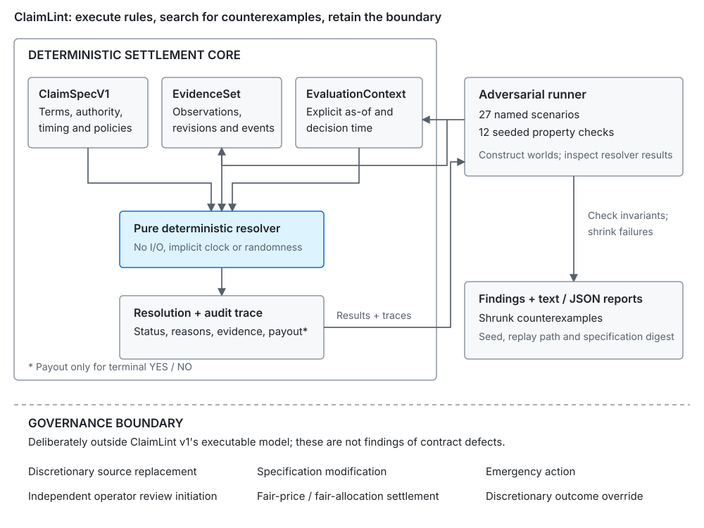

# ClaimLint

**Fuzzing and invariant testing for financial-claim settlement semantics.**

ClaimLint represents externally resolved binary numeric claims as typed terms,
executes them against adversarial evidence states, and searches for undefined or
inconsistent resolution. It tests whether supplied rules determine what happens;
it does not predict the outcome.

**Research result:** no fully supported real contract was found among 24 screened
contracts. Many had a simple numeric core, but incorporated governance and
exceptional-settlement rules exceeded v1. That is a boundary of this model, not a
finding that those contracts are flawed.

## Why

What would fuzzing a financial claim look like? A specification can name a metric,
source and strike yet leave settlement undefined when a publication is missing,
corrected or disputed. JSON validation accepts the shape; adversarial execution
produces the mature evidence state, resolver result and missing rule.

## 30-second demo

Requires **Node.js 24** and **pnpm 10.30.3**. From a clone:

```sh
pnpm install --frozen-lockfile
pnpm build
```

The two synthetic specifications describe fictional Northstar cloud sales above
USD 31 billion. Start with the schema-valid, incomplete version:

```sh
pnpm claimlint check examples/broken-demo.json
```

Actual output, abbreviated:

```text
Counterexample: missing-publication
  Evaluation as-of: 2027-02-04T00:00:00Z
  Supplied evidence: 0 observations; 0 world events
  Resolver: UNDEFINED (MISSING_DATA_POLICY_MISSING)

  ERROR CL004 missing-publication: UNDEFINED [missing-publication]
VERDICT: COUNTEREXAMPLE FOUND
```

Exit **1** is expected. Now run the explicit-policy version:

```sh
pnpm claimlint check examples/hardened-demo.json
```

```text
  DEFINED_REVIEW missing-publication => REVIEW_REQUIRED

Generated property cases: 12000 executed across 12 properties
Runs requested per property: 1000
Seed: 18472941

VERDICT: NO COUNTEREXAMPLE FOUND
```

Exit **0**; both runs exercise the **27 named scenarios**. Review is a defined,
nonterminal route, not a completed settlement. The hardened example also chooses
half-even rounding: `31.04` billion becomes `31.0`, changing that boundary outcome
from YES to NO. Hardening makes contractual choices explicit; it does not preserve
every earlier payout. Passing this bounded search is **not a formal proof**.

## How it works

```ts
resolve(claimSpec, evidenceSet, evaluationContext): ResolutionResult
```

`ClaimSpecV1` contains terms and authority. `EvidenceSet` contains observations,
revision links and world events. `EvaluationContext` supplies time. A pure resolver
returns a decision, stable reason codes, evidence IDs and a typed audit trace.
The checker constructs worlds, executes that resolver, checks invariants and
retains shrunk counterexamples.



### What it checks

- **Static validity:** timing order, source identity/priority, bounded payouts,
  review-process declarations and replacement cycles.
- **Adversarial execution:** missing/late publication, source disagreement,
  revisions, exact boundaries, units, provisional data, outages, period/definition
  changes, duplicates and future evidence.
- **Properties:** determinism, order/duplicate invariance, temporal integrity,
  source precedence, boundary arithmetic, totality, payout bounds and finality
  under the declared cutoff/history assumptions.

There are **12 generated property checks**. Their independence and blind spots
are documented in the [adversarial review](docs/adversarial-review.md); a property
name is not a theorem or a claim of exhaustive coverage.

### Resolution states

| Status            | Meaning                                                             |
| ----------------- | ------------------------------------------------------------------- |
| `YES` / `NO`      | Terminal financial determination with an exact bounded payout.      |
| `PENDING`         | The explicit clock has not reached settlement eligibility.          |
| `REVIEW_REQUIRED` | A policy routes to a named external process; no payout.             |
| `UNDEFINED`       | An exercised state has no applicable rule, or evidence is unusable. |
| `INVALID_SPEC`    | Schema/domain constraints prevent interpretation.                   |

## Real-world research

The project attempted real normalization after an adversarial implementation
review, then broadened the search to test whether the observed limits were
incidental. The results remain public, including unsuccessful attempts.

| Study                                                                                | Result                                                                                                                                                                                               |
| ------------------------------------------------------------------------------------ | ---------------------------------------------------------------------------------------------------------------------------------------------------------------------------------------------------- |
| [Kalshi / Zoom customer KPI](examples/real/zoom-fy2027-customers-100k.provenance.md) | A simple count threshold led to first-report, conditional-authority, dynamic-expiry and fair-price branches. The incomplete draft remains `INVALID_SPEC`.                                            |
| [ProphetX / Gemini volume](examples/real/prophetx-gemini-nov2026-100m/provenance.md) | A synthetic witness gives **USD 110m** with documented per-date fallback, versus **USD 60m** under incorrect whole-source normalization. Void/collateral return and Rule 5.2 actions also exceed v1. |
| [24-contract survey](docs/real-fixture-candidate-survey.md)                          | Six venues screened; seven bound contracts deeply reviewed plus a CME CPI family falsification attempt. No fully supported candidate in the screened set.                                            |

The sample is purposeful, not statistically representative; several contracts
share rulebooks, and some historical governing-version chains remain incomplete.
The recurring boundary lies in source/specification changes, emergency action,
exceptional allocation and event-dependent procedures. Neither unsupported draft
is a finding against its exchange. A CFTC Certified filing records
self-certification, not affirmative product approval or endorsement.

A rule saying "if this supplied condition occurs, route to process Y" can fit
`REVIEW_REQUIRED`. Independent operator initiation while ordinary evidence remains
valid needs an input/state representing that invocation. Naming a process does
not supply that state, and v1 does not pretend to execute it.

Source URLs, dates, hashes and assessments are public. Full publisher bodies
remain optional local archives; see [source provenance and rights](docs/source-archives.md).

## Design principles

- **Deterministic core:** no network, implicit clock, randomness, LLM or mutable
  external state in resolution.
- **Separate evidence from terms:** what happened is distinct from what the
  contract says.
- **Distinguish undefined from pending:** waiting for settlement eligibility is
  different from missing contractual semantics.
- **Execute counterexamples:** inspect resolver behavior, not just field presence.
- **Refuse unsupported normalization:** preserve unrepresented clauses and
  governance branches instead of inventing convenient policies.

## Architecture and use

The [architecture](docs/architecture.md) explains trust boundaries, normalization,
evaluation order and reporting. The [schema reference](docs/schema.md) documents
policies and finding codes; the [threat model](docs/threat-model.md) states the
assumptions.

```sh
pnpm claimlint validate examples/broken-demo.json
pnpm --silent claimlint resolve examples/hardened-demo.json --evidence examples/evidence/exact-strike.json --as-of 2027-02-05T12:00:00Z --format json
pnpm --silent claimlint check examples/hardened-demo.json --runs 1000 --seed 18472941 --format json
```

`--silent` suppresses pnpm's wrapper output for machine-readable JSON. The installed
package exposes the `claimlint` binary and a typed library. `validate` accepts
absent exception policies so `check` can exercise them. `resolve` requires explicit
time; optional `--settlement-at` selects a historical decision time no later than
`--as-of`. Exit codes: **0** defined execution/no error-level counterexample;
**1** semantic finding/undefined resolution; **2** invalid input or inconclusive
execution. Input files are limited to 8 MiB each. Core commands never prompt.

### Reproducibility

Defaults: seed `18472941`, 1,000 runs per generated property. Reports retain engine
version, normalized specification digest, executed counts and findings; generated
failures also retain shrink path and counterexample inputs. Replay requires the
same engine, lockfile, spec, seed, run count, property and path. Shrinking does not
establish a globally smallest counterexample. Counts sum property runs, not
unique worlds or resolver calls; failing properties can stop early.

## Limitations

V1 covers binary numeric claims with exact bigint decimal arithmetic and explicit
Temporal instants. Its finite generators and bounded source/revision inputs do
not cover arbitrary derivative payoffs, per-segment source composition,
discretionary allocations, governance lifecycles or legal-language interpretation.
There is no fully supported real-world contract fixture shipped today.

Passing checks do not establish legal enforceability, regulatory compliance,
economic soundness, external-evidence truth/authenticity, governance correctness
or formal verification. Finality assumes an honest retained evidence history
and a declared cutoff; changing earlier facts changes the input. ClaimLint is
not a settlement ledger or authority for moving funds.

## Status and development

**0.1.1: research prototype.** Node.js 24 is exercised in CI. Tests and examples
run offline after installation; two optional archive-completeness checks skip on
clones without publisher originals. No market data is fetched by the engine.

```sh
pnpm lint
pnpm typecheck
pnpm test
pnpm build
```

The [adversarial review](docs/adversarial-review.md) preserves reproduced defects,
regressions and property limitations. Reproducible issues and focused corrections
are welcome; see [security reporting](SECURITY.md).

## Related work and license

CDM models broader financial products/lifecycles; ACTUS separates contractual
terms from external scenario state. ClaimLint examines a much narrower executable
claim model and implements neither standard. [Primary-source notes](docs/prior-art.md)
cover these and other conceptual references. No affiliation, endorsement or
compliance is claimed.

Original code and analysis: [Apache 2.0](LICENSE). External publications retain
their own rights; [source archive policy](docs/source-archives.md).
