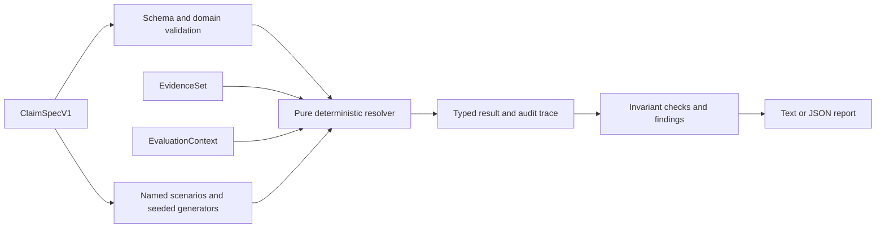

# Architecture

ClaimLint separates contract terms, evidence/world state, and evaluation time.
Its pure resolver is the single implementation of settlement decisions; the CLI
and adversarial runner invoke that same core.



## Modules and boundaries

`model.ts` defines runtime Zod schemas and inferred TypeScript types. Strict
objects reject unknown fields so misspelled policy names do not silently remove
behavior. `validation.ts` checks the relationships a structural schema cannot:
source identity/precedence, fallback cycles, time ordering, period bounds,
binary payout limits, and review-process requirements.

`decimal.ts` implements bounded finite base-10 arithmetic with integer
coefficients and decimal scales. This narrow arithmetic surface avoids a
configurable global precision context. It supports exact comparison, powers of
ten, and explicit rounding; it is not a general financial mathematics library.
The 128-character input budget is a resource constraint, not floating-point
precision. Counts, percentages, and three USD scales are the only units.

`time.ts` uses Temporal instants with explicit offsets. Period calendar labels
are contractual identities; the engine does not infer issuer fiscal calendars or
convert a label such as “Q4” into dates. Observation bounds are explicit instants
and must equal the referenced reporting-period bounds.

`resolver.ts` validates and normalizes inputs, applies temporal and authority
rules, selects eligible evidence, and makes an exact comparison or explicit
exception decision. It performs no I/O and never consults the current clock.
`scenarios.ts` builds deterministic adversarial states, while `check.ts` searches
generated states and checks relational properties using fast-check.

`cli.ts` handles bounded file reads, arguments, output, and exit codes. Importers
can use the library without the CLI. A future natural-language importer could
produce a draft `ClaimSpecV1` for human review; it must not enter the resolver's
decision path.

## Clocks and finality

The contract orders these instants:

```text
observationStart < observationEnd <= publicationDeadline
                 <= determinationAt <= settlementAt
```

All decisions use `settlementAttemptAt` when supplied, otherwise `asOf`.
An attempt cannot be later than `asOf`. Before settlement eligibility the
resolver returns `PENDING`; the runner does not treat that as a vulnerability.

An observation must have both been published and become available to the
evaluation process by the admissible cutoff. `availableAt` means first known to
this evidence history, not an automatically trusted publication timestamp.
Future evidence cannot influence an earlier decision. A wrong entity, metric,
period, or unknown source cannot become authoritative merely by appearing in the
array.

`freezeAtDetermination` fixes the evidence cutoff at `determinationAt`;
`latestUntilSettlement` and `review` fix it at `settlementAt`. The same cutoff
applies to world events. Appending information first available after that cutoff does not
reopen a terminal decision. A backdated publication retrieved later is still
excluded. These policies require an honest, retained, append-only history.
Deletion, substitution, or falsification of old evidence is outside this
finality guarantee.

Absent correction behavior can be resolved for an uncomplicated initial release
yet become `UNDEFINED` when a linked restatement appears. An explicit correction
review policy routes a correction visible by settlement to review and ignores
information first available afterward. The catalogue tests both
before- and after-settlement corrections rather than assuming that a terminal
enum alone creates economic finality.

## Authority and normalization

Sources have unique IDs and unique positive priorities. Lower numbers denote
higher authority. Disagreement requires an explicit source-conflict policy;
the mere existence of priority numbers does not authorize an omitted exception
rule. Priority-based resolution cannot settle contradictory observations within
the same source. Revisions need an explicit predecessor relationship and a
coherent history.

Replacement sources name the source they replace. Validation rejects cycles,
unknown parents, and multiple replacements for one parent. Replacement behavior
requires a policy and a corresponding world event; listing a backup never
silently grants it concurrent authority. A replacement is active only when all
predecessors in its chain are unavailable. An outage does not erase an eligible
observation that was already available before the outage.

Identical observations with the same ID are idempotent. Conflicting contents
under one ID are an evidence-integrity failure. Deterministic sorting produces
stable evidence IDs and logical traces across input permutations. Traces record
major rule applications using codes and typed data, not wall-clock timing or
implementation-dependent object inspection.

Unit conversion requires explicit permission. USD, USD millions, and USD
billions have exact power-of-ten relationships; percentages and counts are not
interchangeable. Explicitly rejected evidence can follow the missing-data rule.
Rounding applies to the normalized observed value using the named mode; the
strike remains exact. Without a rounding policy, the comparison is exact.

## Findings and reproducibility

Schema validity and semantic completeness are distinct. The runner does not
invent an omitted contract policy to reach a result. A mature `UNDEFINED` state
is a counterexample; an explicit review route is defined but non-terminal.
Reports distinguish invalid input, counterexamples, no counterexample found,
and inconclusive execution.

Generated failures retain the property ID, seed, shrink path, shrunk world,
evidence/context, engine version, and normalized specification digest. Use the
same engine, lockfile, specification, property, run count, seed, and path for
replay. Changing generators or the fast-check version can change paths. The
JSON counterexample remains inspectable even when versions change.

Named scenarios cover specific edge cases and give readable examples.
Generators search a finite family of world states. Metamorphic properties test
relationships such as permutation invariance and exclusion of future evidence;
they do not independently prove that the entire business interpretation is
correct. Review routes should be inspected by a human even when every check
passes.
